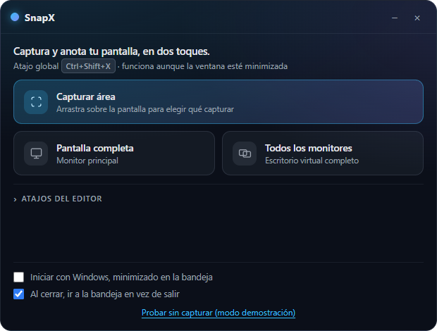
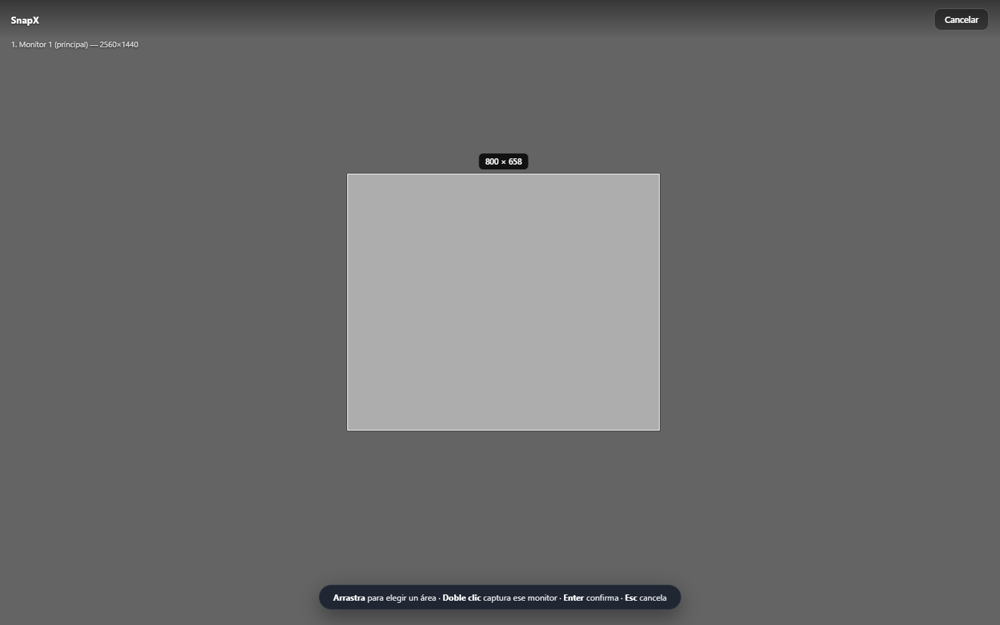
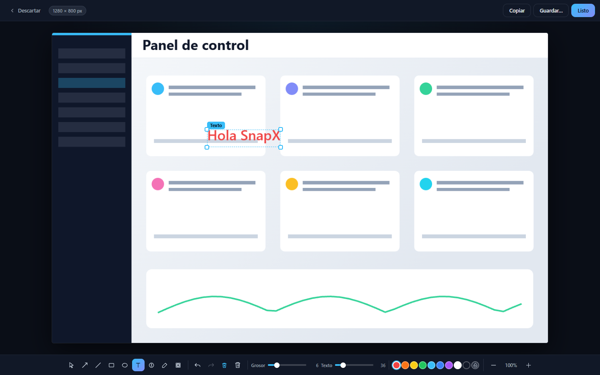

# SnapX — captura y anota tu pantalla en Windows

SnapX es una app de escritorio para Windows con el flujo de trabajo que hizo
famoso a CleanShot X en macOS: capturas rápidas por área, anotación con
flechas, líneas, números, texto, resaltador y pixelado, y acciones de
copiar/guardar. Vive en segundo plano con icono en la bandeja y atajo global.

> Implementación propia desde cero (Tauri 2 + React + Rust). No contiene
> código, arte ni recursos de CleanShot X, que es marca de su propietario.

## Capturas

| Inicio | Selección de área | Editor |
|---|---|---|
|  |  |  |

## Descarga e instalación

1. Ve a [**Releases**](../../releases) y descarga `SnapX_0.1.0_x64-setup.exe`.
2. Ejecútalo y sigue el instalador (no requiere permisos de administrador).
3. Abre SnapX desde el menú inicio.

Requisitos: Windows 10/11 de 64 bits con WebView2 (viene preinstalado).

## Uso

| Acción | Cómo |
|---|---|
| Capturar un área | Botón **Capturar área**, o atajo global **`Ctrl+Shift+X`** (funciona aunque la ventana esté minimizada; si está ocupado se usa `Ctrl+Alt+S` o `Shift+Alt+S` y la app te muestra cuál quedó) |
| Pantalla completa | Botón **Pantalla completa** (monitor principal) |
| Todos los monitores | Botón **Todos los monitores** |
| Seleccionar | Arrastra sobre el overlay oscuro · **doble clic** captura ese monitor · **Enter** confirma · **Esc** cancela |
| Anotar | `A` flecha · `L` línea · `R` rectángulo · `E` elipse · `T` texto · `N` número · `P` lápiz (trazo libre) · `B` pixelar |
| Corregir | `V` seleccionar · clic en una forma para elegirla · arrastra para moverla · tiradores de esquina para escalarla · `Supr` para borrarla |
| Deshacer / rehacer | `Ctrl+Z` / `Ctrl+Y` |
| Texto | Clic donde quieras escribirlo · `Enter` confirma · `Shift+Enter` nueva línea · `Esc` cancela |
| Números | La serie continúa desde el más alto que exista: si borras el 3 con `Supr` o `Ctrl+Z`, el siguiente vuelve a ser **3** (1, 2, 3, 4, 5) |
| Zoom | `Ctrl`+rueda · `Ctrl`+`+` / `Ctrl`+`-` · `Ctrl+0` ajusta a la ventana |
| Terminar | **Listo** (copia y cierra, `Enter`) · **Copiar** (`Ctrl+C`) · **Guardar…** (`Ctrl+S`) · **Descartar** (`Esc`) |

La ventana principal puede moverse (arrástrala), minimizarse y cerrarse a la
bandeja: clic en el icono junto al reloj para abrirla, capturarla o salir.
En **ajustes** (ventana principal) puedes activar **iniciar con Windows**
(arranca minimizada en segundo plano) y **cerrar a la bandeja**.

La ventana del editor se puede redimensionar arrastrando su borde: en capturas
grandes (4K, varios monitores) el zoom ayuda a colocar las anotaciones con
precisión.

## Desarrollo

Requisitos: Node.js 22+, Rust estable (toolchain MSVC) y las
*VS Build Tools* con el workload de C++.

```powershell
npm install
npm run tauri dev      # modo desarrollo (app real)
npm run tauri build    # instalador en src-tauri/target/release/bundle/nsis/
```

### Trabajar solo en la interfaz

```powershell
npm run ui             # http://localhost:5199
```

Levanta el frontend en un navegador normal con las APIs de Tauri simuladas
(carpetas `mock/` y `vite.mock.config.ts`). Sirve para iterar en el diseño sin
recompilar Rust. Se puede entrar al editor con el enlace «Probar sin capturar».

### Tests

```powershell
cd src-tauri
cargo test --lib -- --test-threads=1
```

`--test-threads=1` es necesario porque los tests tocan el portapapeles de
Windows, que es un recurso global.

### Cómo funciona por dentro

- **Captura** (`src-tauri/src/commands.rs`): la crate `screenshots`
  captura cada monitor por DXGI y se cosen en una sola imagen del escritorio
  virtual; el DPI real se lee con `GetDpiForSystem` y el manifiesto incrusta
  `PerMonitorV2` para que el overlay cuadre en pantallas al 125/150 %.
- **Overlay**: ventana transparente a pantalla completa sobre el escritorio en
  vivo (estilo Win+Shift+S); la ventana propia se estaciona fuera de pantalla
  para no salir en la foto.
- **Recorte**: lo hace Rust sobre el PNG (`crop_capture`) y devuelve un data
  URL — así el canvas nunca se contamina por origen cruzado.
- **Editor**: canvas con lista de formas. Cada forma sabe calcular su caja
  (`shapeBounds`), por lo que el mismo código sirve para dibujar el marco de
  selección, detectar el clic encima y escalar desde los tiradores.
- **Lápiz**: trazo libre. Los puntos del ratón se filtran por distancia
  mínima, se promedian con sus vecinos (`smoothPath`) para quitar los ángulos
  y el grosor se modula con la velocidad (`penWidthFactor`), así que el rayado
  afina al acelerar en lugar de salir como una poligonal.
- **Numeración**: el siguiente número se calcula como `máximo(actual) + 1`, no
  con un contador que nunca retrocede. Por eso deshacer o borrar un número
  libera el hueco y la serie vuelve a ser correlativa.
- **Copiar**: comando nativo `copy_image_to_clipboard` → `arboard` → `CF_DIB`.
  Aguanta capturas 4K, a diferencia del plugin de Tauri. Si el comando no
  existe (app compilada contra una versión antigua) el frontend cae al plugin,
  y si ambos fallan muestra los dos errores en pantalla en vez de un
  «no se pudo copiar» genérico.
- **Texto**: el `textarea` de edición vive dentro de `.canvas-wrap`, que tiene
  el tamaño exacto del canvas mostrado, así que aparece justo donde hiciste
  clic y escala junto con el zoom.
- **Segundo plano**: icono de bandeja con menú, atajo global
  (`tauri-plugin-global-shortcut`) e inicio con Windows
  (`tauri-plugin-autostart`, arranca con `--minimized`).

### Diagnóstico

Cada comando deja rastro en `%TEMP%\snapx-debug.log` (los `eprintln` no se ven
en release). Si algo falla, la pantalla de error lo indica y apunta a ese
archivo.

## Estructura

```
snapx/
├── src/                    # React + TypeScript
│   ├── App.tsx             # vistas: home / captura / editor
│   ├── components/         # HomeView, CaptureView, AnnotateView, Toolbar
│   └── lib/                # tipos, geometria de formas y llamadas a Tauri
├── src-tauri/              # Rust
│   ├── src/commands.rs     # captura, recorte, portapapeles, overlay, ajustes
│   ├── src/lib.rs          # bandeja, atajo global, autostart
│   ├── app.manifest        # PerMonitorV2 + controles comunes v6
│   └── capabilities/       # permisos del frontend
├── mock/                   # APIs de Tauri simuladas (solo para `npm run ui`)
├── scripts/                # icono, captura de pantalla (utilidades)
└── assets/                 # icono fuente
```

## Licencia

MIT — ver [LICENSE](LICENSE).